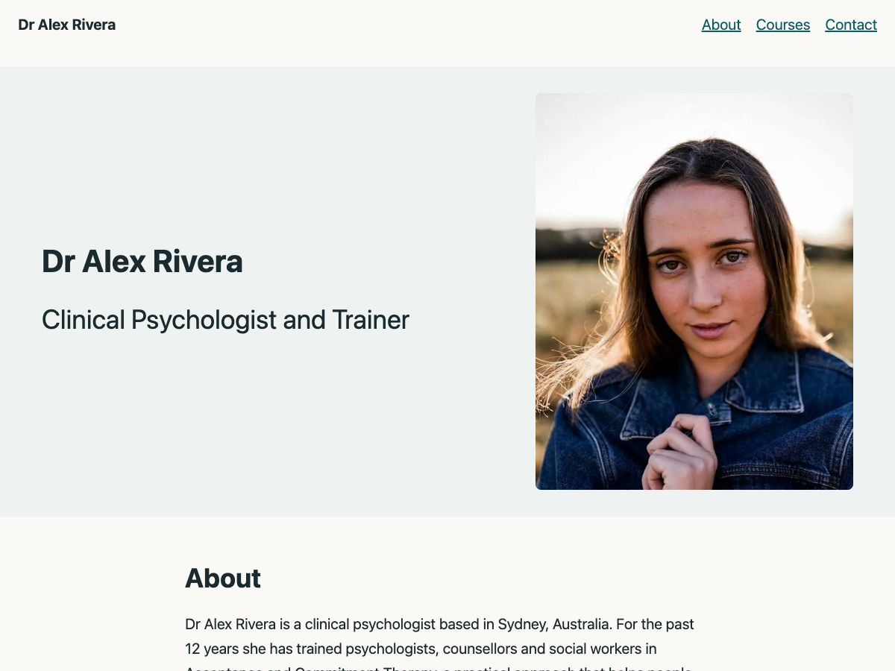

# Psychwire: Dr Alex Rivera block theme



A custom WordPress **block theme** for a one-page site for Dr Alex Rivera, a fictional clinical psychologist and trainer in Sydney. It is my submission for the Psychwire Lead Web Developer technical assessment.

**Live site:** https://psychwire.chrisalberto.me

**Or try it in your browser (no install):**
[Open the live demo in WordPress Playground](https://playground.wordpress.net/?blueprint-url=https://raw.githubusercontent.com/oyic/psychwire-theme/main/blueprint.json)
It installs this theme from this repo into a throwaway WordPress and opens the page.

**At a glance**

| | |
|---|---|
| Stack | WordPress block theme (`theme.json`, HTML templates, PHP patterns), PHP 8+, hand-written CSS |
| Plugins | None. Nothing is added to the admin screens |
| JavaScript | None. The only `<script>` on the page is the JSON-LD data block |
| Content | Verbatim from the brief, held in one PHP file (`inc/data.php`) |
| Quality gates | Lighthouse 99 / 100 / 100 / 100 on the live HTTPS site, PHPCS (WordPress standards) clean, GitHub Actions CI |

---

## How I approached the test

The brief says it is not judging visual design. It judges a well-organised codebase, SEO and AEO, usability, maintainability and accessibility. So I treated it as an engineering exercise and worked in this order:

1. **Read the brief as a checklist.** Every line of the PDF became a requirement I could verify (see the table below).
2. **Chose WordPress** and agreed the design before writing code: a block theme, one source of truth for content, no JavaScript, no plugins.
3. **Built it in small steps**, each one verified against the running site before moving on: skeleton, content data, section patterns, SEO and JSON-LD, accessibility, then photo and docs.
4. **Measured instead of assuming.** I ran Lighthouse, checked the page at 375px, tabbed through it with the keyboard, parsed the JSON-LD, and counted scripts. Every number in this README came from one of those runs.
5. **Had the finished branch reviewed by a separate pair of eyes** (an independent review pass, not the code's author). It found real problems, which I fixed (listed below).
6. **Went past the brief** on the things the brief says it values: SEO/AEO completeness, maintainability and accessibility (see "Added beyond the brief").

I built this with an AI coding assistant (Claude Code), which the brief allows. I directed the decisions, checked the results on the live site, and own the code.

## The brief, requirement by requirement

| Requirement | How it is met |
|---|---|
| Custom Gutenberg block theme, no paid plugins, no admin clutter | Block theme with `theme.json`, templates, parts and patterns. Zero plugins installed. Nothing registered in the admin |
| Top section: name, title, photo | `patterns/hero.php`: H1 name, title, free Unsplash portrait with descriptive alt text |
| About section with the bio | `patterns/about.php`, bio copied word for word |
| Courses section, three courses | `patterns/courses.php`: one card per course with name, description, length and an enquiry link |
| Contact section with her email | `patterns/contact.php`: a plain `mailto:` link |
| Semantic HTML | `header`, `nav`, `main`, `section`, `article`, `footer`; each section is named by its heading |
| Clean, readable code | One job per file, prefixed functions, escaped output, PHPCS clean |
| Accessible | One H1, then H2, H3 in order; alt text; skip link; visible focus; keyboard order checked |
| Content rendered on the server, no JavaScript | PHP renders everything. WordPress's emoji and speculation-rules scripts are removed |
| Works on a phone | Mobile-first, core grid layout, no horizontal scroll at 375px |
| Page title, meta description, clear headings, JSON-LD (Person and Courses) | All printed server-side from the same data as the visible page |
| Send: live site, code, a few lines on what was checked | Playground demo link above, this repo, and the "What I checked" section below |

## Added beyond the brief

These are the extras I added on top of what the brief asked for.

**SEO and AEO**
- **Richer structured data.** One connected JSON-LD graph: `Person`, `Organization` (the course provider), `WebSite`, `WebPage` and three `Course` entries. Each course has an online `CourseInstance`, an ISO 8601 `courseWorkload` and an `instructor`. The monthly supervision course also has a `courseSchedule` (`P1M`). The Person has `knowsAbout`, taken from the bio, so no facts are invented.
- **Canonical URL, Open Graph and Twitter tags**, with a 1200x630 social image.
- **Favicon** (an SVG, so no extra file formats to maintain).
- **Australian English**: `<html lang="en-AU">` and `og:locale`, because the practice is in Sydney.

**Accessibility**
- Each `<section>` is labelled by its heading (`aria-labelledby`), added at render time so the block markup stays valid in the editor.
- Windows high-contrast (`forced-colors`) support, `scroll-margin` on anchored sections, and smooth scrolling only when the visitor has not asked for reduced motion.

**Performance**
- Responsive hero image: a `<picture>` with WebP and JPEG at 400w and 800w, explicit `width`/`height`, and `fetchpriority="high"`. This took Largest Contentful Paint from 1.5 s to 1.1 s.

**Maintainability**
- **Single source of truth.** Profile and courses live in `inc/data.php`. The Courses section, the header, the footer and the JSON-LD all read from it, so the page and its structured data cannot disagree.
- **Translation-ready.** UI labels use `__()` / `esc_html__()` with the `psychwire` text domain.
- **Header and footer are patterns**, so the name and nav labels come from the same data and strings.
- **Coding standards.** PHPCS with the WordPress and PHPCompatibility rulesets (`phpcs.xml.dist`), `.editorconfig`, and a `composer.json` with a `composer lint` script.
- **Continuous integration.** A GitHub Actions workflow runs PHP syntax checks, validates `theme.json`, and runs PHPCS on every push and pull request.
- **Fallback templates.** `index.html` (a real query loop with a "nothing found" state), `singular.html` and `404.html`, so search and error pages are not blank.
- **Theme screenshot** (`screenshot.png`) shown in Appearance, Themes and in this README.
- **One-click demo**: `blueprint.json` drives the Playground link above.

## What I checked

The Lighthouse row below was run on the live site (https://psychwire.chrisalberto.me). The width, keyboard, heading and script checks were run on a local WordPress site, the smoke checks on the live site, and CI on GitHub.

| Check | Result | How |
|---|---|---|
| Lighthouse, live HTTPS site | Performance 99, Accessibility 100, Best practices 100, SEO 100 | Lighthouse, mobile |
| Largest Contentful Paint / CLS / blocking time | 1.6 s / 0 / 0 ms on the live server (1.1 s locally) | Lighthouse |
| Width 375px | No horizontal scroll | Browser measurement: page width equals viewport, no element wider than it |
| Heading order | H1, H2, H2, H3 x3, H2 | Parsed from the rendered HTML |
| Keyboard order | skip link, brand, About, Courses, Contact, email | Focusable elements in DOM order |
| Scripts on the page | 1 (the JSON-LD block) | `curl` of the page |
| JSON-LD | Valid JSON; 7 nodes (Person, Organization, WebSite, WebPage, 3 Course) | Parsed and checked in a script |
| Meta description | 143 characters | Inside the 70 to 160 target |
| Coding standards | PHPCS clean | `composer lint` locally and in CI |
| CI | Passing | GitHub Actions |
| Live smoke checks | 8 of 8 pass: title, one JSON-LD block, one script, canonical, `en-AU`, 3 course cards, hero image, 404 | Run against the live URL |
| `robots.txt` and sitemap | Both served by WordPress | `curl` of the live site |
| Demo link | Installs and activates from GitHub | Opened in a real browser |

**Not done:** I have not pasted the JSON-LD into validator.schema.org or Google's Rich Results Test. Its structure is checked above, but the external validators are worth one manual run. The axe command-line tool would not run on my machine (a Chrome and ChromeDriver version mismatch), so accessibility is covered by Lighthouse, which uses the same axe-core rules, plus the manual keyboard and heading checks.

### Problems found and fixed along the way

- **Styles were not loading.** Block themes do not load `style.css` on the front end by themselves. The theme now enqueues it, and the editor gets it too.
- **Two skip links.** WordPress already adds one, so mine was removed to avoid a duplicate tab stop.
- **Patterns did not appear** right after being created, because WordPress caches the list of pattern files. Clearing transients fixes it during development.
- **The independent review** found and I fixed: blank search and 404 pages; the course `provider` pointing at a Person instead of an Organization; courses locked inside one Custom HTML block; a nav made of loose paragraphs; a wrong minimum WordPress version for `theme.json` v3; missing editor styles; and hero image markup that would fail block validation.
- **Meta description** was 164 characters at first. It is now 143.
- **Editor error on every course card.** The card groups had an invalid layout type (`flow`), which the front end ignored but the block editor could not handle ("This block has encountered an error and cannot be previewed"). Removed; the Site Editor now loads the front page with no console errors and no error blocks.
- **`mailto:` link** is plain HTML, not obfuscated, so crawlers can read it.
- **Pretty URLs on the live host.** WP-CLI could not write `.htaccess` on IONOS, so unknown URLs, `robots.txt` and the sitemap returned the server's own 404. The deploy now writes the standard WordPress rewrite rules.

## Structure

```
style.css          theme header, focus ring, card and hero styling
theme.json         palette, type, spacing, layout widths
functions.php      theme supports, stylesheet, loads inc/*
inc/data.php       profile + courses (single source of truth)
inc/seo.php        title, meta description, canonical, social tags, favicon, JSON-LD
inc/a11y.php       labels each <section> with its heading
inc/cleanup.php    removes core emoji + speculation-rules scripts (zero JS)
templates/         front-page (the one page), index, singular, 404
parts/             header, footer (each just loads a pattern)
patterns/          header, hero, about, courses, contact, footer
assets/images/     hero (webp + jpg, 400w/800w), social image, favicon
blueprint.json     WordPress Playground demo
phpcs.xml.dist     coding standards, composer.json  dev tooling
.github/workflows  CI
```

## Run it locally

1. Copy or symlink this folder to `wp-content/themes/psychwire`.
2. Activate **Psychwire** under Appearance, Themes. The page is the front page whatever the Reading setting is (`front-page.html`).
3. To change content, edit `inc/data.php`. The page and the JSON-LD update together.

During development WordPress caches the list of pattern files. If you add a pattern file and it does not appear, clear transients (`wp transient delete --all`).

**Checks:** `composer install` then `composer lint`.

## Credits and licence

Photo: portrait by Danny Postma on [Unsplash](https://unsplash.com/photos/a-man-in-a-blue-shirt-smiling-at-the-camera-zNxOw2JFNKs), used under the Unsplash License. Cropped and resized. Theme code: GPL-2.0-or-later.
